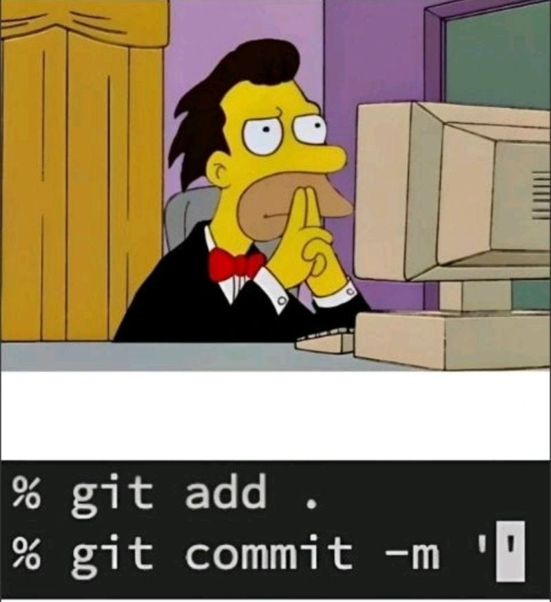

# Collaborative-GitHub-Workflow

the github workflows are truly collaborative

# Helpful learning resources:

- http://tiny.cc/openme (open this)
- https://github.com/deepcoolforce23/Ransom-Doors (i dont recommend running this on a work pc)
- https://www.w3schools.com/python/ (for learning python, they goated)
- https://www.youtube.com/playlist?list=PLD9lr6TpYFMd5hexunvZtd9a_2G7sddRW (the video if ur lazy)
- https://www.youtube.com/watch?v=WAqWUfGIQYI (github tutorial from the khub)
- https://www.crazygames.com/ (for coping)

